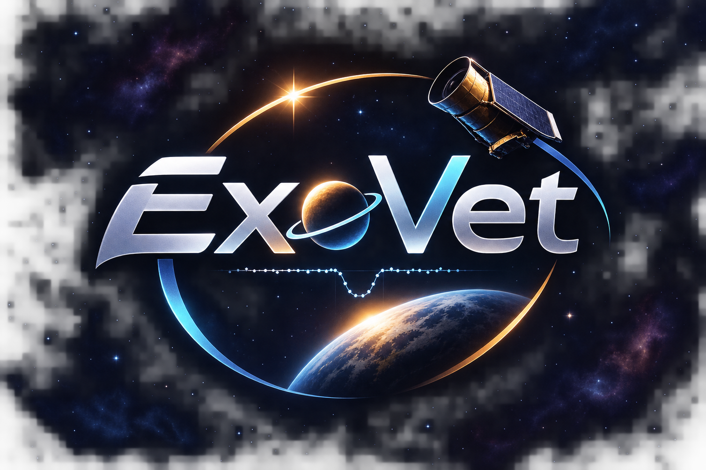
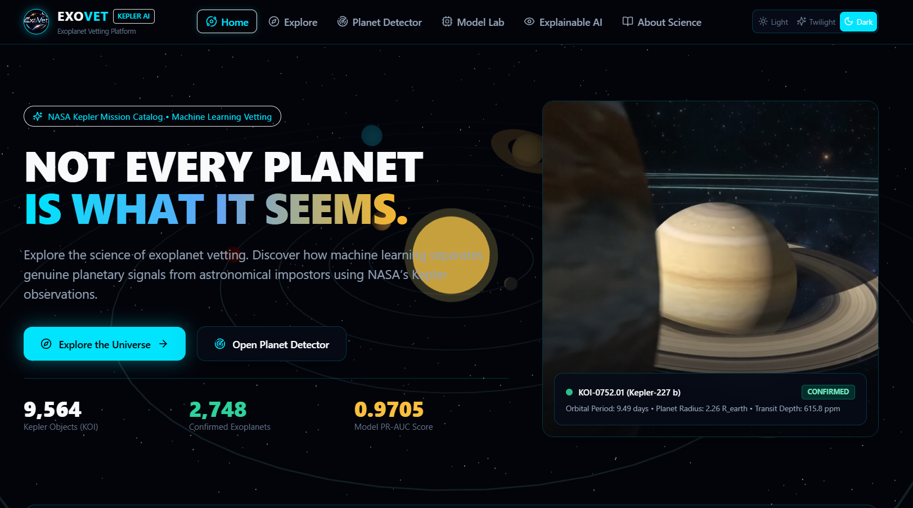
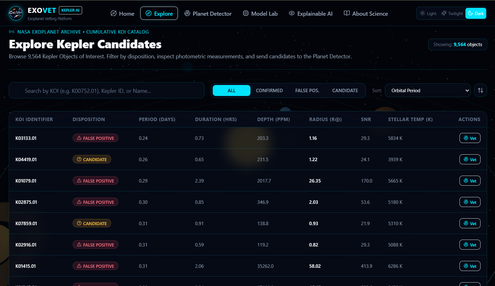
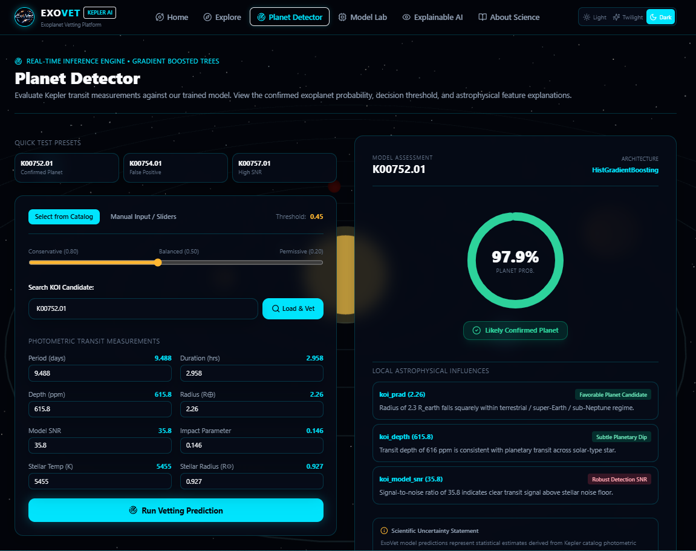
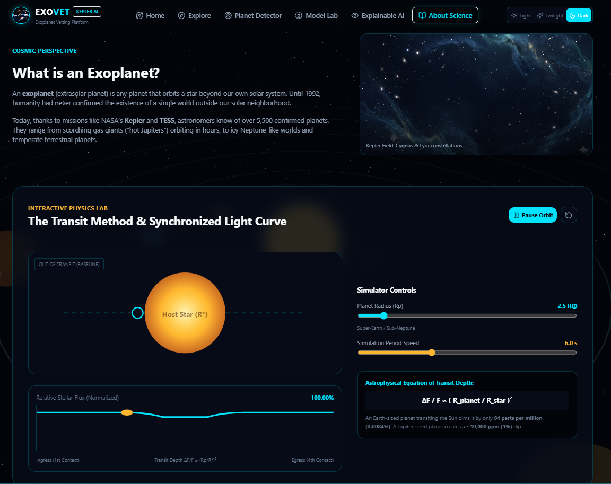
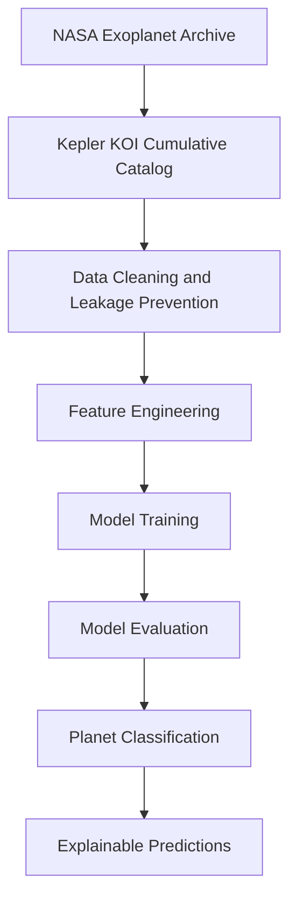

<div align="center">



<br/>

<h1>ExoVet</h1>

<h3>Teaching a model to tell real planets from impostors in NASA's Kepler data.</h3>

<p>
A machine-learning exoplanet vetting platform that separates confirmed planets from false-positive signals<br/>
using NASA's Kepler Objects of Interest catalog, with explainable, threshold-adjustable predictions.
</p>

<p>
  <a href="https://nextjs.org/"></a>
  <a href="https://react.dev/"></a>
  <a href="https://www.typescriptlang.org/"></a>
  <a href="https://tailwindcss.com/"></a>
  <a href="https://threejs.org/"></a>
</p>

<p>
  <a href="https://www.python.org/"></a>
  <a href="https://fastapi.tiangolo.com/"></a>
  <a href="https://scikit-learn.org/"></a>
  <a href="https://pandas.pydata.org/"></a>
  <a href="https://numpy.org/"></a>
</p>

<p>
  <a href="https://vercel.com/"></a>
  <a href="https://exoplanetarchive.ipac.caltech.edu/"></a>
</p>

<p>
  <a href="https://exovet.vercel.app/"></a>
  <a href="https://github.com/dk-khandelwal06/exovet"></a>
  <a href=""></a>
</p>

<br/>



</div>

<br/>

## Overview

ExoVet is an end-to-end exoplanet vetting project: a trained classifier, a FastAPI inference service and an interactive Next.js front end, built on the cumulative **Kepler Objects of Interest (KOI)** catalog from the NASA Exoplanet Archive.

NASA's **Kepler** space telescope watched a patch of sky for years, recording tiny, periodic dips in starlight. Under the **transit method**, a dip can mean a planet is passing in front of its star. The depth of the dip scales with the planet-to-star size ratio, `ΔF/F ≈ (R_planet / R_star)²`, so an Earth-sized planet dims a Sun-like star by only about 84 parts per million.

Each dip-producing object is a *candidate*. It only becomes a *confirmed planet* after vetting, and many candidates turn out to be false positives. Of the 7,587 KOIs in this project that carry a final label, **4,839 are false positives and 2,748 are confirmed planets**. Reviewing candidates by hand does not scale to ever larger surveys, so statistical models can support that triage.

> ExoVet is a learning and demonstration project. It works on catalog-level measurements, not raw light curves, and it does not claim to replace formal astronomical validation.

---

## The Problem and the Solution

<table>
<tr>
<td width="50%" valign="top">

### The Problem

Not every transit-like signal is a planet. Common impostors include:

- **Eclipsing binary stars**, where a stellar companion eclipses the primary.
- **Background blends**, where a distant eclipsing system sits in the same pixel as the target.
- **Instrumental noise and stellar variability** that mimic periodic dips.

Telling these apart needs expert vetting, which is slow and hard to scale across thousands of candidates.

</td>
<td width="50%" valign="top">

### The Solution

ExoVet learns from candidates that already have a final label (confirmed or false positive).

- Trains tree-ensemble classifiers on **physical transit and stellar measurements**.
- Returns a **planet probability** and a verdict at an adjustable decision threshold.
- Explains each prediction with **feature-level influences**, backed by permutation importance and error analysis.
- Keeps the evaluation honest with a dedicated **leakage quarantine**.

</td>
</tr>
</table>

---

## Explore the ExoVet Experience

### 01 — Home | The Cosmic Gateway

An immersive landing page over an animated 3D solar system. It introduces the project's question, shows headline catalog and model statistics (9,564 Kepler Objects of Interest, 2,748 confirmed planets, 0.9705 model PR-AUC), and spotlights a real confirmed candidate, KOI-0752.01 (Kepler-227 b).

<div align="center">

</div>

### 02 — Explore | Kepler Candidate Explorer

A searchable catalog of all 9,564 KOIs. Filter by disposition (confirmed, false positive, candidate), sort by measurements such as orbital period, inspect period, duration, depth, radius, SNR and stellar temperature, and send any object straight to the Planet Detector with the **Vet** button.

<div align="center">

</div>

### 03 — Planet Detector | Machine Learning Predictions

Run real model inference on a catalog candidate or on manually entered transit measurements. A radial gauge shows the planet probability, an adjustable threshold slider moves the decision boundary from conservative to permissive, and local astrophysical influences explain which measurements push the prediction.

<div align="center">

</div>

### 04 — About Science | Transit Physics Laboratory

An interactive transit simulator. Change the planet radius and orbital speed, watch the planet cross its host star, and see the relative stellar flux dip in a synchronized light curve alongside the transit-depth equation.

<div align="center">

</div>

---

## How ExoVet Works



| Stage | What happens |
|---|---|
| **Data source** | The cumulative KOI table (9,564 objects) from the NASA Exoplanet Archive, stored as `data/raw/kepler_cumulative.csv`. |
| **Cleaning and leakage prevention** | Objects labeled *confirmed* or *false positive* form the training set (7,587). *Candidate* objects (1,977) are unlabeled. Vetting-derived columns are excluded. |
| **Feature engineering** | 12 physical measurements plus 6 engineered features: log depth, log period, log radius, depth-to-SNR, transit duty cycle and planet-to-star radius ratio. |
| **Training** | Majority baseline, Logistic Regression, Random Forest and HistGradientBoosting, trained on a stratified 80/20 split (6,069 train, 1,518 test). |
| **Evaluation** | Held-out test metrics and five-fold stratified cross-validation. |
| **Classification** | The best model (HistGradientBoosting) scores a candidate and applies the chosen decision threshold. |
| **Explainability** | Permutation importance on held-out data, per-prediction local influences and false-positive / false-negative error analysis. |

---

## The Leakage Quarantine

The most important lesson in this project is leakage prevention.

The KOI catalog contains columns that were **produced by the vetting process itself**. If a model sees them, it can read the answer instead of learning the physics, and its metrics look excellent for the wrong reason. ExoVet excludes them from both training and inference.

| Excluded column | Why it is quarantined |
|---|---|
| `koi_score` | Vetting-pipeline probability for the object. Using it would leak the final decision. |
| `koi_pdisposition` | The pipeline's own classification, assigned during vetting. |
| `koi_fpflag_nt` | False-positive flag for a non-transit-like event. |
| `koi_fpflag_ss` | False-positive flag for a stellar or secondary eclipse. |
| `koi_fpflag_co` | False-positive flag for centroid offset (background star). |
| `koi_fpflag_ec` | False-positive flag for ephemeris contamination. |
| `koi_comment`, `koi_disp_prov`, `koi_vet_stat`, `koi_vet_date` | Metadata generated after vetting. |

The model instead learns from **physical and transit-related measurements**: orbital period, transit duration, transit depth, planet radius, model SNR, impact parameter, equilibrium temperature, insolation, stellar temperature, stellar surface gravity, stellar radius and Kepler magnitude, plus engineered transforms of these.

A pytest check confirms the excluded columns never enter the training features.

> **Limits of this guarantee.** Excluding these columns removes the most direct leaks, but it does not prove that no subtle leakage remains. The labels themselves come from the same vetting pipeline and its human reviewers, and some catalog measurements are model-derived. Treat the results as strong evidence on this catalog, not as proof of independent validation.

---

## Machine-Learning Models and Benchmarks

All four models were trained on **7,587 labeled objects** (2,748 confirmed, 4,839 false positives) with a stratified 80/20 split, giving 1,518 held-out test objects.

### Held-out test results

| Model | PR-AUC | ROC-AUC | Accuracy | Precision | Recall | F1 |
|---|---:|---:|---:|---:|---:|---:|
| Majority Baseline | 0.3622 | 0.5000 | 63.77% | 0.0000 | 0.0000 | 0.0000 |
| Logistic Regression (scaled) | 0.8598 | 0.9307 | 86.17% | 0.7805 | 0.8600 | 0.8183 |
| Random Forest (150 trees) | 0.9580 | 0.9779 | 93.28% | 0.9043 | 0.9109 | 0.9076 |
| **HistGradientBoosting** | **0.9705** | **0.9837** | **94.27%** | **0.9141** | **0.9291** | **0.9216** |

### Five-fold stratified cross-validation (mean ± std)

| Model | PR-AUC | ROC-AUC | Accuracy | F1 |
|---|---:|---:|---:|---:|
| Logistic Regression | 0.8596 ± 0.0130 | 0.9269 ± 0.0057 | 0.8512 ± 0.0089 | 0.8085 ± 0.0080 |
| Random Forest | 0.9458 ± 0.0082 | 0.9717 ± 0.0036 | 0.9196 ± 0.0049 | 0.8907 ± 0.0054 |
| **HistGradientBoosting** | **0.9576 ± 0.0086** | **0.9777 ± 0.0031** | **0.9301 ± 0.0059** | **0.9045 ± 0.0075** |

**Why PR-AUC is the primary metric.** The classes are imbalanced (confirmed planets are about 36% of labeled objects), so accuracy can look good while saying little: the majority baseline reaches 63.77% accuracy without ever predicting a planet. PR-AUC focuses on how well the model finds true planets (recall) without flooding the output with false alarms (precision). The baseline's PR-AUC of 0.3622 matches the positive-class rate, which is the floor to beat.

**Result.** HistGradientBoosting leads on every held-out metric and in cross-validation, and it powers the Planet Detector. These figures come from a single catalog and a fixed random seed. They are not an independent external validation.

**Permutation importance** on held-out data ranks orbital period, planet radius, model SNR and transit duration as the most influential features.

---

## Key Features

1. **Animated 3D solar system.** A Three.js / React Three Fiber scene with the Sun, eight planets, rotating bodies, revolving orbits and a star-field.
2. **Three visual themes.** Light, Twilight and Dark.
3. **Kepler Candidate Explorer.** Search, disposition filtering, sorting and a candidate details view across all 9,564 KOIs.
4. **Planet Detector.** Real model inference through the API, a probability gauge, an adjustable decision threshold, catalog lookup or manual measurement input, and local feature influences.
5. **Model Lab.** Side-by-side model comparison, evaluation metrics, confusion matrices, ROC and precision-recall curves, and cross-validation tables.
6. **Explainable AI.** Permutation feature importance, a leakage audit, and false-positive / false-negative error analysis.
7. **About Science.** Exoplanet and transit-method education with an interactive transit simulator and a synchronized light curve.

---

## Technology Stack

| Layer | Technologies |
|---|---|
| **Frontend** | Next.js 14 (App Router), React 18, TypeScript, Tailwind CSS, Framer Motion, Lucide React |
| **Backend** | FastAPI, Uvicorn, Pydantic |
| **Machine learning** | scikit-learn (Logistic Regression, Random Forest, HistGradientBoosting, permutation importance), joblib |
| **Data processing** | Pandas, NumPy, SciPy |
| **Visualization** | Recharts, Three.js, React Three Fiber, Drei |
| **Deployment** | Vercel (Next.js front end plus a Python 3.12 serverless function) |

---

## Project Structure

```text
exovet/
├── app/                        # Next.js App Router pages
│   ├── page.tsx                # Home
│   ├── explore/page.tsx        # Kepler Candidate Explorer
│   ├── detector/page.tsx       # Planet Detector
│   ├── model-lab/page.tsx      # Model Lab
│   ├── explainable-ai/page.tsx # Explainable AI
│   ├── science/page.tsx        # About Science (transit simulator)
│   ├── globals.css             # Light / Twilight / Dark themes
│   └── layout.tsx              # Root layout
├── components/
│   ├── 3d/                     # 3D solar-system background
│   ├── navigation/             # Navbar and Footer
│   └── theme/                  # Theme provider
├── api/
│   └── index.py                # FastAPI application
├── ml/
│   ├── data.py                 # Data preparation and leakage audit
│   ├── features.py             # Feature engineering
│   ├── train.py                # Training, cross-validation, benchmarks
│   ├── predict.py              # Inference engine
│   └── artifacts/              # Trained models and metadata.json
├── data/
│   ├── raw/                    # kepler_cumulative.csv
│   └── processed/              # labeled_koi.csv, candidates_koi.csv
├── tests/                      # pytest suite
├── assets/                     # README screenshots
├── requirements.txt            # Python dependencies
├── package.json                # Node scripts and dependencies
└── vercel.json                 # Vercel routing and function config
```

### API endpoints

| Method | Endpoint | Purpose |
|---|---|---|
| `GET` | `/api/health` | Service health |
| `GET` | `/api/metrics` | Model metrics |
| `GET` | `/api/candidates` | Paginated, filterable candidate list |
| `GET` | `/api/candidates/{koi_id}` | Single candidate details |
| `POST` | `/api/predict` | Planet probability for a candidate or manual measurements |
| `GET` | `/api/model-comparison` | Model comparison data |
| `GET` | `/api/feature-importance` | Permutation importance |
| `GET` | `/api/error-analysis` | False-positive / false-negative analysis |

---

## Installation and Local Setup

### Prerequisites

- **Python 3.12+** (the Vercel function targets 3.12; the test suite was run on 3.13)
- **Node.js 18.17+** and npm (Next.js 14 requirement)

### Install

```bash
git clone https://github.com/dk-khandelwal06/exovet.git
cd exovet

# Node dependencies
npm install

# Python dependencies (a virtual environment is recommended)
pip install -r requirements.txt
```

If `npm install` reports a peer-dependency conflict on your setup, retry with `npm install --legacy-peer-deps`.

### Run

```bash
# Start the FastAPI backend and the Next.js frontend together
npm run dev
```

Or run them in separate terminals:

```bash
npm run dev:api    # FastAPI on port 8000
npm run dev:next   # Next.js on port 3000
```

| Service | URL |
|---|---|
| Frontend | http://localhost:3000 |
| API health | http://localhost:8000/api/health |
| API docs (Swagger) | http://localhost:8000/docs |

### Retrain the model (optional)

Pre-trained artifacts are included in `ml/artifacts/`. To retrain:

```bash
npm run train
```

---

## Testing

The pytest suite has **17 tests** in three files:

| File | Covers |
|---|---|
| `tests/test_data_leakage.py` | Raw data present, leakage audit lists all quarantined columns, leakage columns excluded from training features, dataset separation |
| `tests/test_model_inference.py` | Model artifact exists and loads, metadata contains metrics, a confirmed-planet example and a stellar-binary false-positive example are predicted sensibly |
| `tests/test_api_endpoints.py` | Health, metrics, candidate pagination and filtering, candidate details, prediction by KOI ID, feature importance, error analysis |

```bash
python -m pytest tests/
```

When this README was prepared, all 17 tests passed in a fresh virtual environment (Python 3.13) using the dependencies in `requirements.txt` plus `pytest` and `httpx`.

---

## Deployment

The live application is deployed on **Vercel**: **https://exovet.vercel.app/**. The source is hosted at **https://github.com/dk-khandelwal06/exovet**.

To reproduce the deployment:

1. Fork or clone the repository and push it to your own GitHub account.
2. Import the repository in the [Vercel dashboard](https://vercel.com/new).
3. Keep the **Next.js** framework preset. `vercel.json` routes `/api/*` to the Python function at `api/index.py` (runtime `python@3.12`) and bundles `ml/artifacts/**` and `data/raw/kepler_cumulative.csv` with it.
4. Deploy. No credentials are required.

---

## Environment Variables

ExoVet needs **no API keys or secrets**. Both variables below are optional (see `.env.example`).

| Variable | Purpose | Required |
|---|---|---|
| `PORT` | Port for the Next.js server (default `3000`) | Optional |
| `API_URL` | Base URL the Next.js server proxies `/api/*` requests to (local default `http://127.0.0.1:8000`) | Optional |

---

## Scientific References and Acknowledgements

- **NASA Exoplanet Archive**, operated by the California Institute of Technology under contract with NASA: [exoplanetarchive.ipac.caltech.edu](https://exoplanetarchive.ipac.caltech.edu/). Source of the cumulative Kepler Objects of Interest table.
- **NASA Kepler mission data**, distributed through the archive's [data pages](https://exoplanetarchive.ipac.caltech.edu/docs/data.html).
- **Akeson, R. L. et al. (2013).** *The NASA Exoplanet Archive: Data and Tools for Exoplanet Research.* [arXiv:1307.2944](https://arxiv.org/abs/1307.2944).
- **Shallue, C. J. and Vanderburg, A. (2018).** *Identifying Exoplanets with Deep Learning: A Five-planet Resonant Chain around Kepler-80 and an Eighth Planet around Kepler-90.* The Astronomical Journal, 155, 94. [arXiv:1712.05044](https://arxiv.org/abs/1712.05044). A deep-learning approach on raw light curves; ExoVet instead works on catalog-level measurements.

### Disclaimer

> ExoVet predictions are statistical machine-learning estimates based on Kepler catalog measurements. They do not constitute formal astronomical validation or confirmation of an exoplanet.

---

<div align="center">

### Daksh Khandelwal

**AI & Data Science Undergraduate | IIT Jodhpur**

<a href="https://www.linkedin.com/in/daksh-khandelwal-b02748391/"></a>
<a href="https://github.com/dk-khandelwal06"></a>

<br/>

*If ExoVet is useful or interesting to you, consider giving the repository a star.*

</div>
